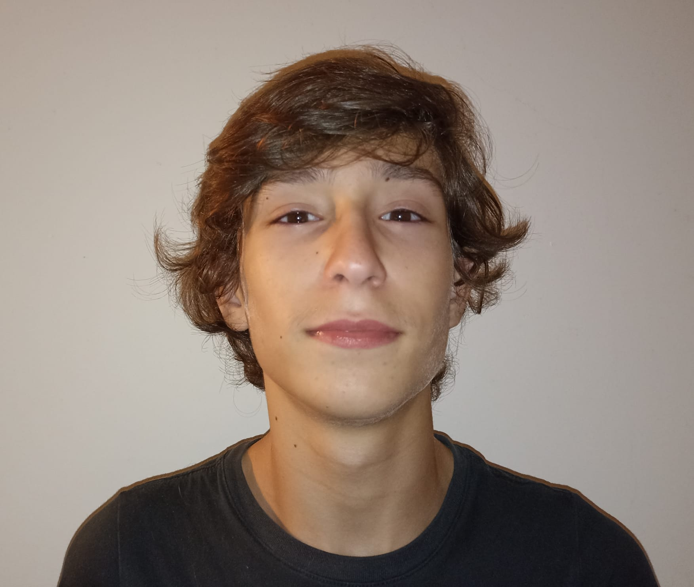
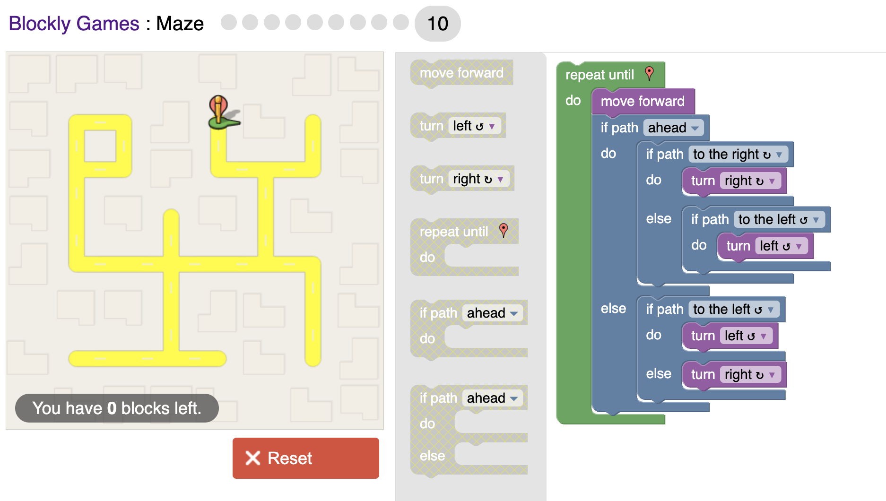
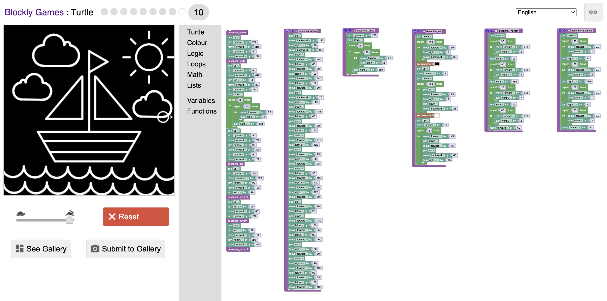

# **ATP TPC1**

- **Nome**: Tomás Duarte Araújo
- **Id**: A113492
- **Foto**:

**Blockly Puzzle: Maze level 10**

O objetivo deste jogo é construir uma sequência de instruções de lógica e decisão para que a personagem navegue pelas curvas e cruzamentos do labirinto sem bater nas paredes nem ficar presa em laços infinitos.
 
Nos níveis iniciais deste jogo não demonstrei nenhuma dificuldade. Contudo, o último nível foi mais desafiante acabando por recorrer a uma abordagem por tentativa e erro.

**Resolução:**

**Blockly Puzzle: Barco à vela no Turtle**

Este jogo testa a capacidade de segmentar um desenho em partes independentes. O seu objetivo é, no menor número de instruções possíveis, unir os diferentes componentes (nuvens, sol, barco e ondas) atravês de cálculos e comandos repetitivos, alcançando no final o desenho completo. 

**Resolução:**

**Links para as resoluções:**

-**Maze level 10:**https://blockly.games/maze?lang=en&level=10&&skin=0#da6uso

-**Barco à vela no Turtle:**https://blockly.games/turtle?lang=en&level=10#fo3eww